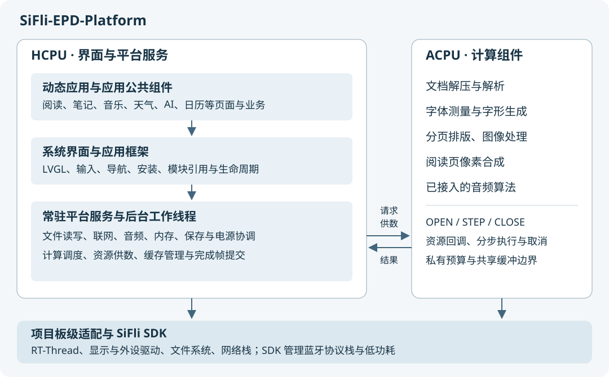

# 系统架构总览

SiFli EPD Platform 是一个为墨水屏设备设计的应用平台。核心特点是**双核分工**和**动态应用**。

## 核心设计

**双核协作**：
- **HCPU**（主处理器）- 处理用户交互、管理文件、运行平台服务
- **ACPU**（协处理器）- 执行计算密集任务（文档解析、排版、渲染）

**动态应用**：
- 应用打包成 `.sap` 文件，可以独立安装和卸载
- 不需要重新烧录固件就能添加新功能

**技术基础**：
- SiFli SDK 2.5.x
- RT-Thread 实时操作系统
- LVGL 9 图形库
- 界面分辨率：684 × 1216

::: tip 相关术语
不熟悉的术语可以查看[术语与缩写](../getting-started/glossary.md)。
:::

## 系统分层

平台采用分层架构，从上到下依次是：

### 动态应用层

**作用**：提供具体功能

包含的应用：
- 书架 - 阅读 EPUB、TXT、Markdown
- 天气 - 查看天气预报
- AI 对话 - 与 AI 助手聊天
- 笔记 - 记录和管理笔记
- 音乐、图库、日历等

**源码位置**：`modules/<app_id>/`

### 应用公共组件

**作用**：提供应用间共享的功能

包含：
- 阅读视图
- 文档解析器
- Markdown 渲染
- HTTP 客户端
- 图像处理

**源码位置**：`modules/common/`

### 系统界面与框架

**作用**：管理应用的运行和显示

包含：
- 桌面和应用启动器
- 设置界面
- 状态栏、通知中心、控制中心
- 输入法键盘
- 应用安装和生命周期管理

**源码位置**：`src/ui/`

### 平台服务

**作用**：提供设备基础能力

包含：
- 存储管理（内部存储 + TF 卡）
- 网络服务（Wi-Fi + 蓝牙）
- 时间同步
- 音频播放和录音
- AI 和语音识别接口
- 电源管理

**源码位置**：`src/services/`、`src/platform/`

### 计算组件

**作用**：在 ACPU 上执行复杂计算

包含：
- 文档转换（EPUB、MOBI、Markdown）
- 字体渲染和字形生成
- 分页排版引擎
- 图像解码
- 页面像素合成

**源码位置**：各组件目录，清单在 `project/compute-components.json`

### 板级适配与 SDK

**作用**：硬件驱动和底层支持

包含：
- 墨水屏驱动和波形
- 触摸、按键驱动
- 文件系统（LittleFS、FAT）
- 网络协议栈（lwIP）
- 蓝牙协议栈
- USB 功能

**源码位置**：`boards/`、`src/boards/`、`SiFli-SDK/`

## 双核如何分工

HCPU 和 ACPU 各有专门的任务，通过统一的计算接口协作。

### HCPU（主处理器）的工作

**UI 线程**：
- 处理触摸和按键输入
- 管理页面生命周期
- 更新 LVGL 界面对象
- 显示后台任务的结果

**工作线程**：
- 读写文件
- 发起网络请求
- 保存配置和数据
- 为 ACPU 提供数据
- 管理阅读结果

**显示线程**：
- LVGL 绘制
- 硬件加速绘图
- 提交到墨水屏驱动

### ACPU（协处理器）的工作

专注于计算密集型任务：
- 解压和解析文档（EPUB、MOBI、Markdown）
- 测量字符尺寸，生成字形位图
- 分页排版计算
- 解码和处理图片
- 合成阅读页面像素

### 蓝牙低功耗核

由 SDK 自动管理：
- 蓝牙协议栈
- 设备扫描和连接
- 蓝牙音频
- 低功耗调度

::: tip 为什么这样分工？
墨水屏的文档处理很消耗 CPU。把这些任务交给 ACPU，可以让 HCPU 保持响应，界面操作不会卡顿。
:::

## 应用的运行

### 安装

应用以 `.sap` 包的形式分发。安装时平台会：
1. 检查包格式和完整性
2. 验证应用清单
3. 确认 ABI 版本兼容
4. 解压到选定的存储位置（内部存储或 TF 卡）

构建固件时也可以预装应用到文件系统镜像。

### 加载和运行

用户打开应用时：
1. 应用框架加载 `.so` 模块
2. 绑定平台提供的公共函数
3. 调用应用的 `app_main()` 入口
4. 进入页面生命周期

### 退出

应用可以有后台任务。退出过程按顺序执行：

1. **停止新任务** - 不再接收新的工作请求
2. **取消进行中的任务** - 停止网络、文件操作等
3. **保存状态** - 调用 `flush()` 保存必要数据
4. **清理后台资源** - 关闭文件、释放内存
5. **清理 UI 资源** - 删除页面对象
6. **卸载模块** - 释放程序代码占用的内存

::: warning 重要
退出页面不等于删除数据。应用的配置和用户数据保存在文件系统中，卸载应用时才删除。
:::

详见[应用生命周期](../development/application-lifecycle.md)和[应用存储](../development/application-storage.md)。

## 阅读器的工作流程

书架应用是平台最复杂的功能之一。从打开书籍到显示页面，涉及 HCPU 和 ACPU 的多次协作。

### 完整流程

**1. 打开书籍**
- HCPU 读取书籍信息和上次阅读位置
- 确定要显示的章节或段落

**2. 文档转换**
- HCPU 读取书籍文件和资源
- ACPU 解压、解析文档内容
- 提取文本、目录、图片等信息

**3. 准备字体**
- HCPU 选择用户设定的阅读字体
- ACPU 解析字体文件
- 测量字符尺寸，生成需要的字形位图

**4. 分页排版**
- HCPU 提供文本、样式和页面尺寸
- ACPU 计算分页位置和行布局
- 确定每页显示哪些文字和图片

**5. 页面合成**
- HCPU 提供字形、图片和输出缓冲
- ACPU 把文字、图片合成为完整页面

**6. 显示**
- HCPU 绑定完成的页面
- 通过 LVGL 和墨水屏驱动显示
- ACPU 可以继续准备下一页

::: tip 资源请求机制
ACPU 缺少数据时会暂停，请求 HCPU 提供。数据到达后从暂停的地方继续，不需要重新开始。
:::

### 位置恢复

阅读位置保存的是**源文件位置**，而不是页码。因为页码会随着字体、字号、页面尺寸变化。

**不同格式的恢复方式**：

- **EPUB** - 记录章节 ID 和章节内偏移，可以独立解析各章节
- **TXT** - 记录字节偏移，向前找段落边界恢复位置
- **Markdown/MOBI** - 使用转换记录中的位置，优先用缓存

### 后台预备

为了流畅翻页，阅读器会后台预备页面：
- 当前页优先显示
- 后台转换和排版相邻页面
- 复用已有的缓存（文档内容、排版结果、字形）

**多层缓存**：
1. 文档内容缓存
2. 排版结果缓存
3. 字体度量缓存
4. 字形位图缓存
5. 完成页面帧缓存

每层缓存有独立的预算。”某页已排版”只是完成了布局计算，真正显示还需要字形和图片都准备好。

::: tip 相关实现
- 文档转换：`modules/books/compute/`
- 阅读字体：`components/compute_reader_font/`
- 页面合成：`components/compute_reader_render/`
- 页面缓存：`modules/common/reader/reader_page_cache.c`
:::

## 计算组件接口

HCPU 和 ACPU 通过统一的计算接口通信。每个计算组件都有自己的协议和数据格式。

### 组件声明

每个组件用 `compute.json` 声明：
- 两侧的源码文件
- 公共头文件
- 支持的操作
- 版本信息

项目清单选择哪些组件编译进固件。

### 调用流程

一次计算按固定步骤执行：

1. **查询能力** - 检查组件是否可用
2. **等待准入** - 等待计算资源
3. **OPEN** - 建立计算会话
4. **STEP** - 分步执行（算法可以分多次完成，不阻塞调度）
5. **CLOSE** - 关闭会话，释放资源

**资源请求**：
- ACPU 可以在 STEP 中暂停，请求 HCPU 提供数据
- 数据到达后从暂停点继续
- 不需要重新开始计算

### 数据交换

**共享缓冲**：
- 包含地址、容量、长度、读写方向
- 遵循对齐和缓存同步规则
- 调用方持有缓冲直到远端确认结束

**生命周期**：
- 取消请求表示结束工作
- CLOSE 成功才表示远端已释放资源
- 旧会话未关闭前，其缓冲不能给新任务使用

::: tip 组件开发
如何开发新的计算组件，详见[平台扩展](../contributing/platform-development.md#hcpu-与-acpu)。
:::

**相关源码**：
- 计算接口：`src/platform/epd_compute.h`
- 调度器：`src/platform/epd_compute.c`
- 传输层：`src/platform/epd_compute_transport.c`
- 组件清单：`project/compute-components.json`

## 内存管理

设备的 PSRAM 总共 16 MiB，分配给两个核心：
- **HCPU**：13.5 MiB
- **ACPU**：2.5 MiB（另有 64 KiB 片上 RAM）

实际可用容量要扣除系统占用。

### HCPU 的内存

**SRAM**：
- 内核对象
- 控制结构
- 有硬件要求的缓冲
- 容量有限，大块数据用 PSRAM

**应用 PSRAM**：
- 文本内容
- 图片数据
- 阅读缓存
- 网络响应
- 工作缓冲

用 `epd_app_alloc(..., EPD_APP_PSRAM)` 分配。分配失败不会自动用 SRAM。

**LVGL 内存池**：
- UI 对象和绘制系统专用
- 不能和应用内存合并计算

### ACPU 的内存

- 算法上下文
- 计算栈
- 解析和解码缓冲
- 由各组件预算和调度器共同管理

### 跨核共享缓冲

用于交换请求和结果：
- 生命周期由在途会话和显示使用者决定
- 会话结束前不能复用

### 内存不足时

平台有自动回收机制：

1. **阻止后台应用自动加载**
2. **寻找可回收的后台服务**
3. **要求服务保存状态**（调用 `flush()`）
4. **发出停止请求**
5. **等待服务退出并释放内存**

**保护规则**：
- 前台应用受保护，不会被强制退出
- 后台服务要声明可回收才能被回收
- 音乐等需要持续运行的服务默认受保护

**回收限制**：
- 有调用者的服务不能回收
- 有未保存数据且正在修改的服务会延迟回收
- 默认等待最多 5 秒

::: warning 注意
释放的总内存达到要求，不保证有同样大的连续块。内存碎片会影响大块分配。
:::

**相关实现**：
- 分区表：`project/sf32lb57-epd-gyd7n6_hcpu/ptab.json`
- 内存接口：`src/platform/epd_memory.h`
- 压力协调：`src/platform/app_memory_pressure.c`
- 服务回收：`src/services/app_service.c`

详见[应用内存](../development/application-memory.md)。

## 存储管理

设备有两个存储位置：
- `/flash` - 内部存储（4.625 MiB LittleFS）
- `/sdcard` - TF 卡（FAT32）

### 存储用途

**内部存储**：
- 平台固件和资源
- 已安装的应用
- 应用配置数据
- 系统设置

**TF 卡**：
- 电子书文件
- 音乐、图片
- 笔记内容和附件
- 应用安装包
- 也可以安装应用到 TF 卡

### 存储服务

平台提供统一的存储服务：
- 协调读写操作
- 管理文件版本
- 处理介质变化

**存储锁**：
- 耗时操作要分段持有存储锁
- 纯内存计算不需要锁
- 避免长时间占用

### TF 卡变化处理

**拔出或插入 TF 卡时**：
1. 相关应用停止访问
2. 撤销资源和缓存
3. 依赖卡上程序的应用会被处理（暂停或关闭）
4. 重新插入后恢复挂载

**USB 读卡器模式**：
- 电脑独占访问 TF 卡
- 设备暂停访问卡上文件
- 关闭读卡器后恢复设备访问

::: tip 安全操作
使用 USB 读卡器后，要在电脑上**安全弹出磁盘**，然后再关闭读卡器。
:::

**相关实现**：
- 存储服务：`src/services/storage.c`
- 文件版本：`src/services/storage_file.c`

## 显示和电源

### 墨水屏刷新

**两种刷新模式**：
- **局部刷新** - 快（300-500ms），可能有残影
- **全局刷新** - 慢（1-2秒），完全清除残影

平台的刷新协调器会根据内容变化和用户设置自动选择。累计多次局刷后会自动全刷。

**刷新流程**：
1. 阅读器后台生成页面帧
2. UI 线程提交给 LVGL
3. LVGL 绘制
4. 墨水屏驱动显示

**三个完成阶段**：
- 像素计算完成
- 帧提交完成
- 物理刷新完成

### 电源管理

**锁屏和休眠是两回事**：
- **锁屏** - 仅阻止触摸操作
- **系统休眠** - 还需要保存状态、停止服务、准备外设

**休眠流程**：
1. 保存服务状态
2. 停止后台任务
3. 准备外设进入低功耗
4. 显示墙纸并全刷
5. 等待显示完成
6. 进入休眠

**恢复流程**：
1. 恢复板级硬件状态
2. 恢复计算调度
3. 恢复阅读字体服务
4. 恢复外设
5. 恢复应用服务

**电源约束**：
- USB 读卡器工作时不能休眠
- 音频播放时不能休眠
- 计算未完成时不能深度休眠
- 各服务通过电源约束表达需求

**相关实现**：
- 刷新协调：`src/ui/platform/epd_refresh.c`
- 电源状态机：`src/ui/platform/epd_power.c`
- 计算电源：`src/platform/epd_compute_pm.c`

详见[电源管理](../services/power-management.md)。

## 继续学习

**开发应用**：
- [第一个应用](../development/first-application.md) - 创建简单应用
- [应用生命周期](../development/application-lifecycle.md) - 页面和后台任务
- [应用内存](../development/application-memory.md) - 内存分配和管理
- [应用存储](../development/application-storage.md) - 保存配置和数据

**深入架构**：
- [阅读与双核计算](reading-architecture.md) - 阅读器详细流程
- [应用运行](application-runtime.md) - 任务和数据交接
- [内存与存储](memory-storage.md) - 资源生命周期
- [显示与输入](display-input.md) - 刷新和交互
- [电源与恢复](power-architecture.md) - 休眠和唤醒
- [网络与音频](network-audio.md) - 在线服务

**扩展平台**：
- [公共组件](../development/common-components.md) - 组件开发
- [平台扩展](../contributing/platform-development.md) - 添加新功能

网络服务统一发布可用上行与状态。默认策略优先使用可用 WLAN，WLAN 不可用且 PAN 已连接时才使用 PAN。蓝牙设备连接与 PAN 网络连接分别管理，普通蓝牙连接不以 PAN 成功作为条件。

AI、天气、语音和校时通过网络服务使用连接，各自维护业务结果与错误；联网本身不代表某个远端服务已经可用。接口说明见[网络服务](../services/wifi.md)、[AI 服务](../services/ai-services.md)和[语音服务](../services/speech-services.md)。

音频服务负责播放、录音、输出设备与媒体会话。当前项目开启 SDK 软件混音，允许音乐与触摸提示音等声音共同输出。平台的输出选择、输入格式和音量含义遵循对应音频接口，具体算法通过计算组件接入。

## 构建产物与分区

主工程生成 HCPU 固件、公共资源和 ACPU 固件，应用使用配套导出接口构建 `.sap`。文件系统镜像可叠加预装应用，波形文件随板型提供。

当前 Flash 布局来自项目分区表（源码：`project/sf32lb57-epd-gyd7n6_hcpu/ptab.json`）：

| 内容 | 起始地址 | 区域上限 |
| --- | --- | --- |
| HCPU 程序 | `0x12020000` | 3552 KiB |
| 内置资源 | `0x12398000` | 6552 KiB |
| ACPU 程序 | `0x129FE000` | 888 KiB |
| 蓝牙持久数据 | `0x12ADC000` | 16 KiB |
| 墨水屏波形 | `0x12AE0000` | 256 KiB |
| 内部文件系统 | `0x12B20000` | 4.625 MiB |
| TF 卡 DFU | `0x12FC0000` | 256 KiB，含两个持久化扇区 |

构建命令、生成文件与烧录步骤见[构建与部署](../build/building.md)。SDK 来源由源码仓库的 `.gitmodules` 和子模块提交共同记录；上游修复的合入状态应在 SDK 改动清单中单独维护。

## 继续阅读

- [应用生命周期](../development/application-lifecycle.md)：页面、受管任务、模块引用和退出。
- [应用内存](../development/application-memory.md)、[应用存储](../development/application-storage.md)：公共接口与资源使用。
- [公共组件](../development/common-components.md)、[平台扩展](../contributing/platform-development.md)：组件接入和双核构建。
- [阅读与双核计算](reading-architecture.md)：文档、字体、排版和页面合成的数据流。
- [应用运行](application-runtime.md)、[内存与存储](memory-storage.md)：任务与数据的持有、交接和释放。
- [显示与输入](display-input.md)、[电源与恢复](power-architecture.md)、[网络与音频](network-audio.md)：子系统的运行状态和协作流程。
