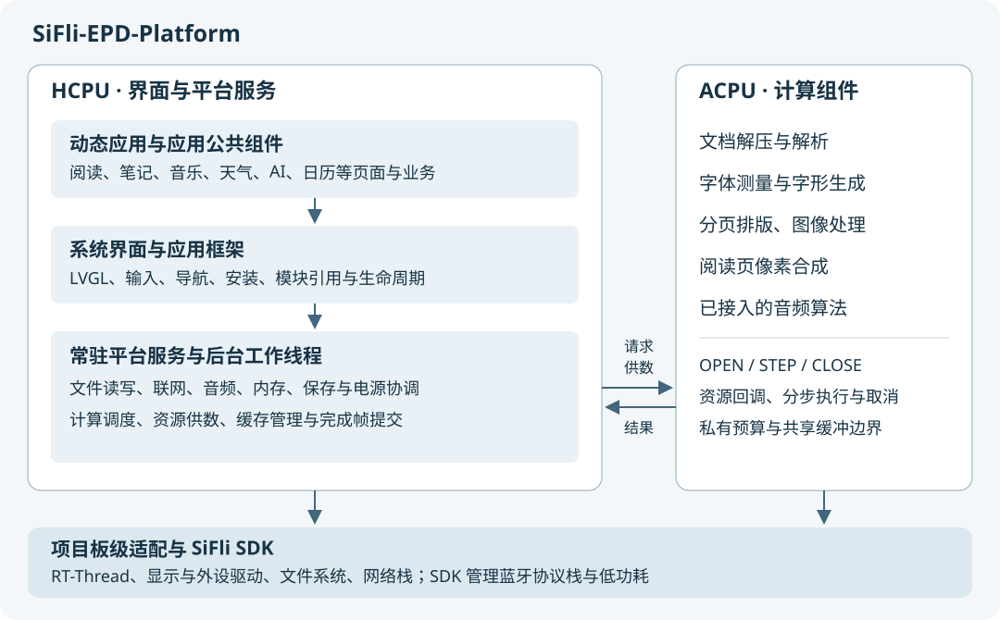

# 系统架构总览

SiFli EPD Platform 由常驻平台固件、动态应用和配套计算固件组成。主处理核 HCPU 负责用户交互、文件访问和设备服务，协处理核 ACPU 执行接入计算框架的算法；蓝牙协议栈及其低功耗调度由 SDK 管理。相关概念见[术语与缩写](../getting-started/glossary.md#开发中的术语)。

平台基于 SiFli SDK 2.5.x、RT-Thread 和 LVGL 9。当前项目板型为 `sf32lb57-epd-gyd7n6_hcpu`，界面分辨率为 684 × 1216。以下描述对应当前项目实现，具体配置来源列在各节。

## 系统分层

| 层次 | 主要职责 | 实现入口 |
| --- | --- | --- |
| 动态应用 | 书架、天气、AI 对话、看板、日历、图库、音乐、笔记等应用的页面和业务数据。 | `modules/<id>/` |
| 应用公共组件 | 编入应用的阅读视图、文档访问、Markdown、HTTP 和图像等能力。 | 源码：`modules/common/`、书架文档服务（源码：`modules/books/document/document.c`） |
| 系统界面与应用框架 | 桌面、设置、状态栏、控制中心、键盘、通知、导航、安装与模块生命周期。 | 源码：`src/ui/` |
| 常驻平台服务 | 存储、网络、时间、音频、AI、语音、计算调度、内存和电源协调。 | 源码：`src/services/`、源码：`src/platform/` |
| 计算组件 | 文档转换、字体、排版、图像、页面合成及已接入的音频算法。 | 计算组件清单（源码：`project/compute-components.json`） |
| 板级适配与 SDK | 线程与通信、驱动、文件系统、网络栈、蓝牙栈，以及屏幕供电、波形、引脚和外设。 | 源码：`boards/`、源码：`src/boards/`、`SiFli-SDK/` |

动态应用通过平台导出的公共接口使用设备能力，业务实现留在应用或应用公共组件中。动态模块与 HCPU 固件共享地址空间；页面、服务和回调通过引用关系维持模块寿命。

源码、文档、构建产物分别管理：本库保存系统说明，组件详细说明留在源码旁，`project/` 与 `tools/` 定义固件、应用包和文件系统镜像的生成过程。

## 核与线程的分工

| 执行位置 | 负责的工作 | 交接方式 |
| --- | --- | --- |
| HCPU 界面线程 | 处理触摸、按键、页面生命周期和 LVGL 对象；消费后台结果并更新界面。 | 通过状态快照和待处理结果与后台协作。 |
| HCPU 工作线程 | 文件读写、网络请求、持久化、计算供数、阅读预备及结果管理。 | 发布结果；跨核等待放在工作线程中。 |
| HCPU 显示相关线程 | LVGL 绘制、硬件绘图和屏幕提交。 | 完成通知决定帧与资源何时可以复用。 |
| ACPU | 文档解压解析、字体测量和字形生成、分页排版、图像处理、阅读页像素合成，以及清单允许的音频计算。 | 使用组件名称、版本和专用数据协议，通过统一计算接口调度。 |
| 蓝牙低功耗核与 SDK 蓝牙任务 | 蓝牙协议和控制器工作，处理扫描、连接、音频等请求。 | 平台使用 SDK 的蓝牙接口和事件；核的低功耗由 SDK 调度。 |

组件是否可以执行，由构建清单、注册表及板级准入配置（源码：`project/sf32lb57-epd-gyd7n6_hcpu/compute.json`）共同决定。清单中出现某个组件，不等于该板已允许它运行；例如用于回声消除、降噪和自动增益等音频前处理的 [Anyka 3A](../getting-started/glossary.md#开发中的术语)，当前仍未开放执行。

主入口（源码：`src/main.c`）先初始化电源与显示，再启动文件系统、应用安装、网络、设置、校时和界面。主循环交替处理电源状态、界面任务、LVGL 和延后清理，通过事件或下一次截止时间等待后续工作。

## 动态应用的运行与退出

应用以 `.sap` 包分发。安装器负责包格式、完整性、应用清单和二进制接口兼容检查，将程序及资源发布到选定存储；构建时也可以把应用预装到文件系统镜像中。

运行时，应用框架加载模块并绑定公共符号，再进入应用与页面生命周期。受管后台服务可以在页面退出后继续工作。模块的页面、任务和外部调用均结束后，框架才具备卸载模块的条件。

退出涉及异步任务时，处理顺序为：

1. 停止接收新工作，向正在执行的任务发布取消或停止状态。
2. 工作线程结束读写和计算，完成必要的保存，关闭计算会话及资源。
3. 界面线程处理最终结果和控件释放，延后清理阶段回收服务引用。
4. 模块不再被任何活动执行路径引用后，释放程序与相关内存。

程序内存、应用持久数据、可重建缓存具有不同寿命。退出页面并不等同于删除数据，也不等同于立刻卸载后台服务。

实现入口：模块管理（源码：`src/ui/platform/app_module.c`）、受管服务（源码：`src/services/app_service.c`）。应用接入方式见[生命周期](../development/application-lifecycle.md)和[应用存储](../development/application-storage.md)。

## 阅读数据流

### 打开书籍到显示正文

书架使用应用公共阅读组件组织流程，平台计算服务负责把算法请求送到 ACPU。文件系统操作与算法通过资源请求交接。

| 阶段 | HCPU 的工作 | ACPU 的工作 | 输出 |
| --- | --- | --- | --- |
| 打开与恢复 | 读取书籍身份、保存位置和阅读设置，确定目标章节或源位置。 | 根据请求处理目标内容。 | 目标文档与位置。 |
| 文档转换 | 按请求读取书籍和相关资源，消费转换记录并管理临时记录文件与索引。 | 解压、解析正文、目录、标题、链接、注释及图片。 | 带源位置的文本、结构、目录和图像记录。 |
| 字体准备 | 选择平台全局阅读字体，提供外置字体字节，管理字体身份、缓存和使用引用。 | 解析字体、测量字符、生成灰度字形。 | 字符尺寸、行高、字形位图。 |
| 分页排版 | 提供文本、样式、字体度量和页面几何参数，保存页位置与排版结果。 | 执行分页与行布局计算。 | 页面文字与资源的位置。 |
| 页面合成 | 提供字形、图片和输出缓冲，管理完成帧的寿命。 | 将文字、图片和图形合成为阅读页像素。 | 可交给显示系统的页面帧。 |
| 屏幕显示 | 绑定完成帧，更新标题、页码和交互元素；经 LVGL 和屏幕驱动提交。 | 当前帧计算完成后，可继续处理后续计算请求。 | 墨水屏上的阅读页面。 |

ACPU 在缺少资源字节时，保存当前计算上下文并请求 HCPU 供数；字节到达后从原位置继续。读取、计算和显示分别有自己的等待与完成条件。

内置压缩字体在支持的板型上可由 ACPU 直接读取映射资源；外置字体通过资源请求供数。系统菜单使用界面字体，正文通过平台阅读字体服务取得所选字体和对应版本。

### 恢复位置与预备页面

阅读位置以章节和源位置为核心保存，页码由当前字体、字号和页面尺寸决定。排版参数变化后，阅读器据源位置恢复内容，再生成新页面。

| 格式 | 当前定位方式 |
| --- | --- |
| EPUB | 按 spine 选择目标章节，保留全书目录；解析目标章以恢复样式和正文位置，其他章节正文可独立处理。 |
| TXT | 按源文件字节位置取片段，并在有界前文窗口内寻找段落与字符边界。 |
| Markdown、MOBI | 使用转换记录中的位置恢复；持久缓存命中时直接访问记录，缓存缺失时仍需进行文档转换。 |

当前页优先，后台继续转换、预排和准备相邻页面。文档内容、排版结果、字体度量、字形位图和完成帧是不同层次的缓存。“某页已排版”只说明位置计算完成，实际翻页还需要该页的字形、图片与可用帧。

新的前台目标可以取消尚未完成的旧目标。旧计算会话关闭确认之前，仍保留其引用的输入、输出和资源；这些缓冲不能同时交给新任务复用。缓存预算和任务状态决定实际可保留的范围。

具体协议及边界见文档转换（源码：`modules/books/compute/README.md`）、字体组件（源码：`components/compute_reader_font/README.md`）、排版组件（源码：`modules/common/reader/compute.json`）、页面合成（源码：`components/compute_reader_render/README.md`）和阅读页缓存（源码：`modules/common/reader/reader_page_cache.c`）。

## 计算组件接入与资源交接

组件由 `compute.json` 声明两侧源码、公共头文件、远端操作和版本，再由项目清单选择。ACPU 算法编入配套计算固件，动态应用调用 HCPU 侧的组件客户端。

一次计算按“查询能力 → 等待准入 → OPEN → 分步 STEP → CLOSE”执行。分步调用让算法在有界工作后交还调度；资源请求还可以在 STEP 内暂停并等待供数。组件使用专用的数据布局，算法私有上下文留在 ACPU。

共享缓冲包含地址、容量、有效长度和读写方向，并遵循平台要求的对齐及缓存同步规则。调用方持有缓冲直到远端确认结束；取消表示请求结束工作，CLOSE 成功才意味着远端已释放相应引用。

当前阅读计算路径在远端不可用或失败时上报状态，由阅读流程处理；文档转换、字形生成和页面合成没有自动切回 HCPU 完整执行的路径。

实现入口：计算公共接口（源码：`src/platform/epd_compute.h`）、计算调度（源码：`src/platform/epd_compute.c`）、传输层（源码：`src/platform/epd_compute_transport.c`）、组件清单（源码：`project/compute-components.json`）。接入步骤见[平台扩展](../contributing/platform-development.md#hcpu-与-acpu)。

## 内存布局与回收

当前分区表为 HCPU 划出 **13.5 MiB PSRAM**，为 ACPU 划出 **2.5 MiB PSRAM**；ACPU 另有 64 KiB 片上 RAM 区域。这是地址空间划分，实际可分配容量还要扣除静态数据、各内存池和常驻资源。

| 资源 | 用途与管理方式 |
| --- | --- |
| HCPU SRAM | 内核对象、控制结构和有硬件限制的缓冲。大块应用数据按用途分配到 PSRAM。 |
| HCPU 应用 PSRAM | 文本、图像、阅读缓存、网络响应及工作区；由 `epd_app_alloc(..., EPD_APP_PSRAM)` 等接口管理。分配失败不会自动挤占 SRAM。 |
| LVGL 内存池 | 界面对象及绘制体系的内存，按对应分配接口释放；不能与应用内存池的空闲量合并理解。 |
| ACPU 私有内存 | 算法上下文、计算栈、解析与解码工作区，由各组件预算和公共调度共同限制。 |
| 跨核共享缓冲 | 两核交换请求、源数据和计算结果的区域，其寿命由在途会话与显示使用者共同约束。 |
| 内部 Flash、TF 卡 | 持久数据和可重建缓存；需要时重新读取，属于应用显式持久化。 |

平台的内存压力协调器在需求不能满足时，阻止后台应用自动重新加载，并逐步寻找可回收的后台服务。当前前台应用被保护；候选服务必须主动声明可回收，且没有调用者或数据修改保护引用。协调器先要求保存，再发出停止请求，等待 worker 和模块引用实际释放。

当前源码中，天气服务显式加入了这套回收机制。机制本身支持其他服务接入，但不能据此认定所有后台应用都已能被回收。音乐和未声明可回收的服务默认受到保护。

回收请求有完成、资源不足和超时状态，默认等待上限为 5 秒。请求接口本身不等待；总空闲量达到要求也不保证存在同样大小的连续内存块。当前平台没有把任意运行中的应用内存自动换出到 Flash 的通用机制，数据落盘依赖应用自己的保存与重载流程。

实现依据：分区表（源码：`project/sf32lb57-epd-gyd7n6_hcpu/ptab.json`）、内存接口（源码：`src/platform/epd_memory.h`）、内存压力协调（源码：`src/platform/app_memory_pressure.c`）、服务回收（源码：`src/services/app_service.c`）。开发接口见[应用内存](../development/application-memory.md)。

## 存储与外部访问

内部文件系统挂载在 `/flash`，TF 卡挂载在 `/sdcard`。应用程序、业务数据和缓存按平台与应用约定分别存放；应用安装在内部存储，也可以把业务数据放在 TF 卡，例如笔记正文和附件。

公共存储服务协调读写、文件版本和介质状态。耗时后台操作分段使用存储锁，纯内存计算不需要长期占有该锁。最终文件替换仍需保证版本和介质状态一致。

TF 卡拔出或转交 USB 读卡器时，存储状态变化会使相关使用者停止访问，撤销对应资源与缓存身份，并处理依赖卡上程序的应用。USB 读卡器期间由电脑访问卡上文件，关闭读卡器后再恢复设备侧挂载与使用。

存储服务（源码：`src/services/storage.c`）和文件版本与提交（源码：`src/services/storage_file.c`）提供共用机制，各应用负责结束自己的在途访问。设备操作见[设备与网页管理](../getting-started/device-management.md)。

## 显示、输入与电源

触摸和按键事件由 HCPU 处理，界面线程负责页面与控件。阅读器后台产出页面帧，界面将完成帧提交给 LVGL；刷新协调器根据内容变化和用户设置安排局刷或全刷。像素计算完成、帧提交完成和墨水屏物理刷新完成分别表示不同阶段。

锁屏是交互状态；系统休眠还需要完成服务保存、任务收尾和外设准备。进入墙纸时提交一次全刷，并等待显示完成。网络、蓝牙、电池与校时服务分别提供准备和恢复步骤；平台不能仅凭显示了墙纸就认定所有硬件已进入低功耗。

计算调度通过休眠保护协调在途请求。计算传输尚未停稳时，电源回调拒绝进入对应低功耗模式；恢复时先恢复板级状态，再恢复计算派发、阅读字体服务、外设和应用服务。

USB 读卡器、音频和其他持续工作通过各自的电源约束表达工作需求。锁屏计时、系统休眠状态和 SDK 的空闲省电属于不同层次，详细接口见[电源管理](../services/power-management.md)。

实现入口：刷新协调（源码：`src/ui/platform/epd_refresh.c`）、电源状态机（源码：`src/ui/platform/epd_power.c`）、计算电源接入（源码：`src/platform/epd_compute_pm.c`）。

## 网络与音频服务边界

网络服务统一发布可用上行与状态。默认策略优先使用可用 WLAN，WLAN 不可用且 PAN 已连接时才使用 PAN。蓝牙设备连接与 PAN 网络连接分别管理，普通蓝牙连接不以 PAN 成功作为条件。

AI、天气、语音和校时通过网络服务使用连接，各自维护业务结果与错误；联网本身不代表某个远端服务已经可用。接口说明见[网络服务](../services/wifi.md)、[AI 服务](../services/ai-services.md)和[语音服务](../services/speech-services.md)。

音频服务负责播放、录音、输出设备与媒体会话。当前项目开启 SDK 软件混音，允许音乐与触摸提示音等声音共同输出。平台的输出选择、输入格式和音量含义遵循对应音频接口，具体算法通过计算组件接入。

## 构建产物与分区

主工程生成 HCPU 固件、公共资源和 ACPU 固件，应用使用配套导出接口构建 `.sap`。文件系统镜像可叠加预装应用，波形文件随板型提供。

当前 Flash 布局来自项目分区表（源码：`project/sf32lb57-epd-gyd7n6_hcpu/ptab.json`）：

| 内容 | 起始地址 | 区域上限 |
| --- | --- | --- |
| HCPU 程序 | `0x12020000` | 3424 KiB |
| 内置资源 | `0x12378000` | 6560 KiB |
| ACPU 程序 | `0x129E0000` | 880 KiB |
| 蓝牙持久数据 | `0x12ABC000` | 16 KiB |
| 墨水屏波形 | `0x12AC0000` | 256 KiB |
| 内部文件系统 | `0x12B00000` | 5 MiB |

构建命令、生成文件与烧录步骤见[构建与部署](../build/building.md)。SDK 来源由源码仓库的 `.gitmodules` 和子模块提交共同记录；上游修复的合入状态应在 SDK 改动清单中单独维护。

## 继续阅读

- [应用生命周期](../development/application-lifecycle.md)：页面、受管任务、模块引用和退出。
- [应用内存](../development/application-memory.md)、[应用存储](../development/application-storage.md)：公共接口与资源使用。
- [公共组件](../development/common-components.md)、[平台扩展](../contributing/platform-development.md)：组件接入和双核构建。
- [阅读与双核计算](reading-architecture.md)：文档、字体、排版和页面合成的数据流。
- [应用运行](application-runtime.md)、[内存与存储](memory-storage.md)：任务与数据的持有、交接和释放。
- [显示与输入](display-input.md)、[电源与恢复](power-architecture.md)、[网络与音频](network-audio.md)：子系统的运行状态和协作流程。
